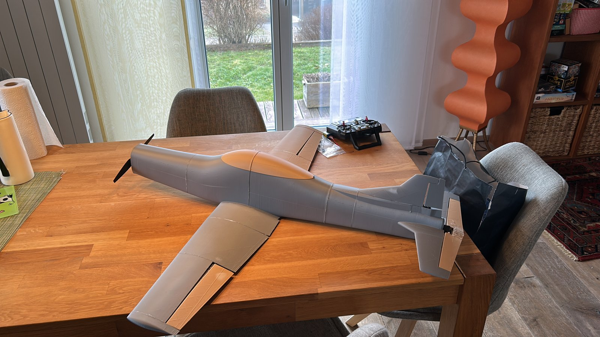

# pc7-mk2-simtoolkit

**From simulation to sky: modelling, simulating, 3D-printing and flying a 1:10 Pilatus PC-7 MkII.**



*Modèle réduit du PC-7 MkII : modélisation OpenVSP, 18 simulations VSPAERO automatisées en
Python, construction imprimée en 3D et essais en vol. Travail de maturité, Gymnase du
Bugnon (Lausanne), Prix d'excellence SVSN 2026.*


[](https://doi.org/10.5281/zenodo.24382179)

## Overview

This repository contains the files of a *travail de maturité* (Swiss high-school final-year project)
on the Swiss training aircraft Pilatus PC-7 MkII:

1. the aircraft was remodelled in **OpenVSP** from Pilatus' 1:25 reference drawing;
2. two wing parameters were optimised by simulation with **VSPAERO** at 1:10 scale:
   the outer-wing **dihedral** (0, 5, 7, 10, 15, 20°) and the **airfoil thickness**
   (NACA 64(2)-410, -415, -420), giving **18 configurations**, each computed for
   α = −10…15° and β = 0, 15, 30°;
3. a **Python script** ran all cases automatically (12 days, 5 h, 36 min of computation)
   and compiled the results;
4. outlier iterations from the solver were corrected and the configurations ranked;
5. the best configuration was turned into a **3D-printable model in Fusion 360**, built and
   flight-tested.

The work won the SVSN 2026 prize
([Prix SVSN](https://wp.unil.ch/svsn/releve/prix-svsn/)) and is the subject of an
article in the *Bulletin de la Société Vaudoise des Sciences Naturelles* (Frésard & Kobel,
2026).

## Results

One configuration (`angle_15_TC_1`) returned only invalid values (NaN) and was discarded;
the 17 others were ranked by the integral of L/D (to maximise) and of the moment-coefficient
derivative C<sub>M</sub>′ (to minimise) over α ∈ [−10, 15]°, averaged over the three values
of β:

| Model | ∫ L/D dα | ∫ C<sub>M</sub>′ dα | ∫ C<sub>Mx</sub>′ dα | ∫ C<sub>My</sub>′ dα | ∫ C<sub>Mz</sub>′ dα | Mean rank |
|---|---:|---:|---:|---:|---:|---:|
| **angle_10_TC_15** | 192.64 | 1.13 | 0.04 | 1.36 | −0.01 | **3.7** |
| angle_5_TC_15 | 178.71 | 1.33 | 0.04 | 1.38 | −0.01 | 4.3 |
| angle_0_TC_1 | 178.34 | 0.94 | 0.08 | 0.96 | 0.06 | 5.0 |
| angle_7_TC_15 (real aircraft) | 160.60 | 1.20 | 0.05 | 1.57 | −0.01 | 9.0 |

Model names give the dihedral and the thickness/chord ratio: `angle_10_TC_15` = 10°
dihedral, 15 % thickness (`TC_1` = 10 %, `TC_2` = 20 %).

The retained configuration, **10° dihedral and 15 % thickness**, was built. The finished
model weighs about 1.7 kg, almost three times the 0.61 kg assumed for the simulations, so it
needs about 21 m/s to stay level instead of the planned 12.6 m/s. The first five hand
launches followed a parabolic path; on the sixth, the aircraft stayed in the air on its
own for about 5 seconds. See the TM report and the article for the full discussion
(Reynolds-number effects, limits of VSPAERO, mass budget).

## Repository structure

```text
pc7-mk2-simtoolkit/
├── cad/
│   ├── PC7-MkII.f3d           # Fusion 360 design of the printable aircraft
│   └── PC7-MkII-STEP.zip      # STEP export of the whole aircraft
├── models/
│   └── PC7-MkII.vsp3          # OpenVSP aerodynamic model (base for the 18 variants)
├── simulations/
│   └── database.json          # VSPAERO iterations of the 17 valid models
├── src/
│   ├── simulations_main.py    # builds the 18 models and runs CompGeom + VSPAERO
│   ├── origin.vspaero         # VSPAERO settings used for all cases
│   ├── extract_database.py    # compiles the .history files into database.json
│   ├── extract_data_from_polar.py  # reads VSPAERO .polar files
│   ├── GetGraphs.ipynb        # outlier correction, plots and ranking (Table above)
│   └── analyse.ipynb          # convergence exploration
├── docs/
│   ├── TM_PartI.pdf           # TM report, part I (theory, method)
│   ├── TM_PartII.pdf          # TM report, part II (results, construction, bibliography)
│   ├── REFERENCES.md          # third-party documents used, with links
│   └── images/                # photo of the model
├── requirements.txt
├── CITATION.cff               # citation metadata (GitHub)
├── .zenodo.json               # archive metadata (Zenodo)
├── LICENSE                    # MIT (code)
└── LICENSE-DATA.md            # CC BY 4.0 (models, data, CAD, TM report)
```

## CAD files (Fusion 360 / STEP)

The printable aircraft is in the [`cad/`](cad) folder (also attached to the
[latest release](https://github.com/Arloup/pc7-mk2-simtoolkit/releases/latest)):

| File | Content |
|---|---|
| `PC7-MkII.f3d` (≈ 34 MB) | Fusion 360 design, fully editable (open with *File → Open → Open from my computer*) |
| `PC7-MkII-STEP.zip` (≈ 28 MB, 105 MB unzipped) | STEP export of the whole aircraft, for any CAD software (FreeCAD, SolidWorks, Onshape…) |

STL files are not provided: for 3D printing, export each part separately from Fusion 360
(right-click on a body → *Save as Mesh*), as the aircraft must be printed in pieces.

## Reproducing the analysis

The results can be analysed without OpenVSP, from the database:

```bash
git clone https://github.com/Arloup/pc7-mk2-simtoolkit.git
cd pc7-mk2-simtoolkit
pip install -r requirements.txt
cd src
jupyter notebook GetGraphs.ipynb   # reproduces the ranking table above
```

### Re-running the simulations

`src/simulations_main.py` needs:

- **OpenVSP 3.43.0** and its Python API (`openvsp` module, shipped with OpenVSP and tied to
  the Python version of the build — Python 3.9 for the Windows build used here);
- the **VSPAERO settings file** `src/origin.vspaero` used for the project (included):
  Mach 0.052, α from −10 to 15° by 1°, β = 0, 15, 30°, 40 wake iterations, reference
  values S<sub>ref</sub> = 0.1625 m², c<sub>ref</sub> = 0.1642 m, b<sub>ref</sub> = 1.0124 m.

> **Note on ReCref.** `simulations/database.json` was computed with `ReCref = 3.36 × 10⁶`.
> `origin.vspaero` uses the Reynolds number of the model based on the reference chord
> (1.99 × 10⁵), as expected by VSPAERO. This parameter only affects the skin-friction
> estimate.

Edit the paths at the top of the script, then:

```bash
python simulations_main.py                 # ~6 h per model on 10 threads
python extract_database.py C:\TM_Simulations\results -o ../simulations/database.json
```

## Building the model

- **Printing:** FDM, standard PLA (LW-PLA-HT was planned but could not be printed
  reliably), 0.2 mm layers, 50 mm/s, 235 °C; fuselage in four sections, each
  wing in three parts, fin and tailplanes separate.
- **Assembly:** strong glue, with toothpicks as alignment pins.
- **Radio control:** digital transmitter and receiver, LiPo battery, outrunner brushless motor
  with a two-blade propeller and its ESC, servos glued directly to the control surfaces.
  No gyro or flight stabiliser.

## Citation

Files of this repository (archived on Zenodo):

> Frésard, A. (2026). *Un avion suisse en modèle réduit : de la modélisation aux essais de vol
> du PC-7 MkII en passant par la simulation numérique et la conception – données, scripts et
> fichiers 3D*. Zenodo. <https://doi.org/10.5281/zenodo.24382179>

Article:

> Frésard, A. & Kobel, P. (2026). Un avion suisse en modèle réduit : de la modélisation aux
> essais de vol du PC-7 MkII en passant par la simulation numérique et la conception.
> *Bulletin de la Société Vaudoise des Sciences Naturelles* (forthcoming).

## Licence

Code: [MIT](LICENSE). Models, simulation data, CAD files and TM report:
[CC BY 4.0](LICENSE-DATA.md). Third-party references are listed in
[`docs/REFERENCES.md`](docs/REFERENCES.md) and are not redistributed.

## Contact

Arthur Frésard — arthurfresard@bluewin.ch
